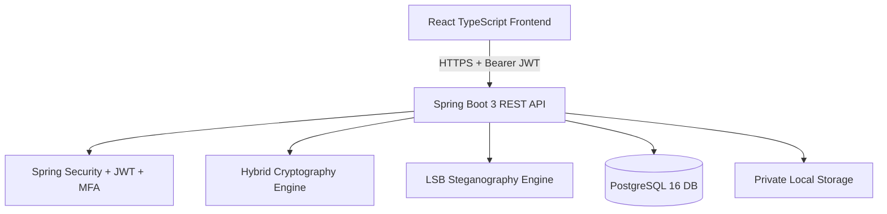

# MASTER SYSTEM SPECIFICATION

## Project Title
**A Multi-Layer Secure File Storage and Sharing Framework Using Hybrid Cryptography and Steganographic Key Management in Cloud Environments**

**Institution:** SJC Institute of Technology (SJCIT), Department of Computer Science & Engineering  
**Academic Level:** Final-Year BE CSE Major Project  
**Author / Team:** BE CSE Final Year Project Candidates  
**Date:** October 2026  
**Status:** Architecture & Implementation Baseline  

---

## 1. Executive Summary & Problem Formulation
Modern cloud storage systems rely heavily on single-layer symmetric encryption (typically server-managed AES-256) where cloud service providers (CSPs) retain or manipulate the cryptographic keys. Such centralized architectures expose sensitive organizational data to insider threats, hypervisor-level compromises, regulatory non-compliance, and cryptanalytic breakthroughs.

This framework introduces a five-layer defense-in-depth architecture:
1. **Layer 1: Pre- and Post-Decryption Integrity Assurance (SHA-256)** — Validates data integrity across transport and storage, detecting tampering or corruption.
2. **Layer 2: Authenticated Primary Encryption (AES-256-GCM)** — Provides confidential payload encapsulation with 128-bit authentication tags and Additional Authenticated Data (AAD) binding file metadata.
3. **Layer 3: Academic Cryptographic Comparison Layer (Blowfish-CBC)** — Implements a secondary symmetric cipher with independently derived key material, serving both as an academic comparative evaluation of 64-bit block ciphers and an inner diffusion stage.
4. **Layer 4: Asymmetric Key Encapsulation (ECDH over NIST P-256 + HKDF-SHA-256)** — Establishes secure key agreement for the ephemeral per-file Data Encryption Key (DEK), eliminating static master-key vulnerabilities and supporting fine-grained sharing.
5. **Layer 5: Lossless Carrier Concealment (Spatial LSB Steganography in PNG)** — Embeds the wrapped cryptographic envelope within a lossless carrier image using parity-checked least significant bit encoding with explicit payload-length framing and CRC-32 integrity validation.

---

## 2. Multi-Layer Cryptographic Pipeline Specification

### 2.1 Layer 1: Integrity Verification (SHA-256)
- **Standard:** NIST FIPS 180-4 Secure Hash Standard.
- **Specification:**
  $$\text{Checksum} = \text{SHA-256}(M)$$
  where $M$ is the raw byte sequence of the original plaintext file.
- **Verification Rule:** Decrypted bytes $M'$ must satisfy $\text{SHA-256}(M') \equiv \text{Checksum}$ using constant-time comparison `MessageDigest.isEqual()`.

### 2.2 Layer 2: Authenticated Symmetric Encryption (AES-256-GCM)
- **Standard:** NIST SP 800-38D (Galois/Counter Mode).
- **Parameters:**
  - Key size: 256 bits (32 bytes), cryptographically random via `SecureRandom`.
  - Nonce/IV: 96 bits (12 bytes), guaranteed unique per encryption invocation.
  - Authentication Tag: 128 bits (16 bytes).
  - Additional Authenticated Data (AAD): Concatenation of File UUID, Owner UUID, and Original Filename UTF-8 bytes.
- **Ciphertext Output:** $C_{AES} = \text{AES-GCM-Encrypt}(K_{DEK}, IV_{GCM}, M, AAD)$

### 2.3 Layer 3: Secondary Diffusion & Academic Comparison Layer (Blowfish-CBC)
- **Cipher:** Blowfish by Bruce Schneier (1993).
- **Parameters:**
  - Key size: 128 bits (independent sub-key derived via HKDF-Expand).
  - Mode: Cipher Block Chaining (CBC) with PKCS#5 / PKCS#7 padding.
  - Initialization Vector: 64 bits (8 bytes) fresh random IV.
- **Security Note & Academic Context:** Blowfish has a 64-bit block size and is susceptible to birthday-bound collision attacks beyond $2^{32}$ blocks (approx. 32 GB of data encrypted under the same key). The framework documents this constraint rigorously and relies on AES-256-GCM as the primary authenticated cipher.

### 2.4 Layer 4: Asymmetric Key Protection (ECDH + HKDF-SHA-256)
- **Curve:** NIST P-256 (`secp256r1` / `prime256v1`).
- **Key Agreement:**
  - Ephemeral Key Pair: $(d_{eph}, Q_{eph})$ where $Q_{eph} = d_{eph} \cdot G$.
  - Recipient Public Key: $Q_{rec}$.
  - Shared Secret: $Z = d_{eph} \cdot Q_{rec}$.
- **Key Derivation (RFC 5869):**
  $$K_{wrap} = \text{HKDF-Extract-and-Expand}(Z, \text{salt}_{32}, \text{info}=\text{"SecureStorage-KeyWrap-v1"}, L=32)$$
- **Key Wrapping:** The per-file 256-bit $K_{DEK}$ and Blowfish sub-key are encrypted under $K_{wrap}$ using AES-KeyWrap (RFC 3394) or AES-256-GCM.

### 2.5 Layer 5: Spatial LSB Steganographic Concealment
- **Carrier Format:** 24-bit RGB or 32-bit RGBA lossless PNG image.
- **Payload Structure:**
  `[Magic: 4 bytes ("SECK")] | [Version: 1 byte] | [Payload Length: 4 bytes BE] | [Encapsulated Envelope: N bytes] | [CRC32: 4 bytes]`
- **Embedding Algorithm:**
  For each bit $b_i$ of the framed payload:
  $$P_i' = (P_i \ \& \ \sim 1) \ | \ b_i$$
  where $P_i$ is the color component byte of pixel $i$.
- **Capacity Constraint:** Carrier must satisfy:
  $$\text{Width} \times \text{Height} \times 3 \ge (\text{PayloadLength} + 13) \times 8$$

---

## 3. Role-Based Access Control (RBAC) Specification

| Role | Permitted Actions | Prohibited Actions |
| :--- | :--- | :--- |
| **USER** | Upload, encrypt, list, download, decrypt own files; share with registered users; generate shared links; manage notifications; manage personal profile. | Accessing administrator routes/APIs; viewing other users' private files without an explicit share; modifying another user's permissions or accounts. |
| **ADMIN** | Access administrator dashboard, view aggregated storage statistics, list system users, activate/suspend user accounts, view audit logs, view security event feeds, inspect system health. | Downloading or viewing plaintext files of users; intercepting or extracting private ECC keys; bypassing file decryption authorization. |

---

## 4. Threat Model & Security Controls

1. **Insecure Direct Object Reference (IDOR):**
   - *Threat:* Malicious user changes file UUID in `GET /api/files/{id}/download` to access another user's file.
   - *Mitigation:* The backend database query and authorization filter enforce that the caller is either the owner (`owner_id == caller_id`) or has an active, unexpired, unrevoked entry in `file_shares`.
2. **Tampered Encrypted File / Storage Tampering:**
   - *Threat:* Storage provider or malicious actor modifies encrypted bytes in local storage.
   - *Mitigation:* AES-256-GCM authentication tag verification fails immediately, aborting decryption before any plaintext is released. Layer 1 SHA-256 ensures end-to-end integrity.
3. **One-Time Share Link Replay:**
   - *Threat:* Attacker intercepts or reuses a consumed one-time share link.
   - *Mitigation:* Token hashes are stored in the database. Access count increment and `access_count >= 1` check are executed in an atomic transaction; replay attempts return `410 Gone` and generate an audit log.
4. **Brute-Force OTP & Account Enumeration:**
   - *Threat:* Automated scripts guess 6-digit OTP codes.
   - *Mitigation:* OTPs expire after 5 minutes; failed attempt counter enforces lock-out after 5 failed tries; generic error messages prevent user enumeration.

---

## 5. Architectural Diagram Overview

