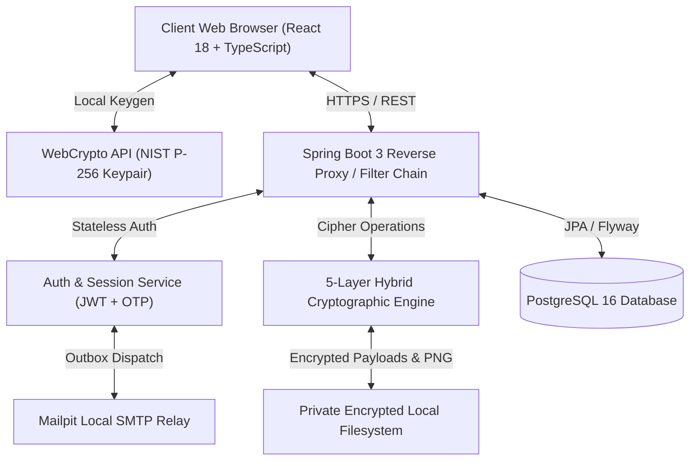
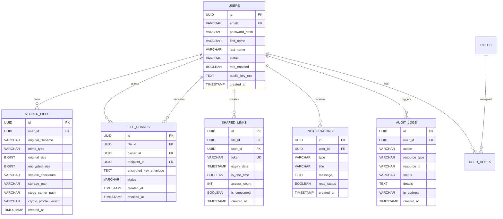
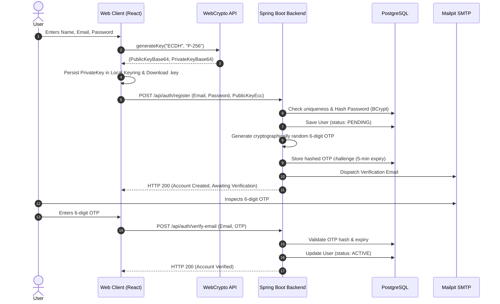
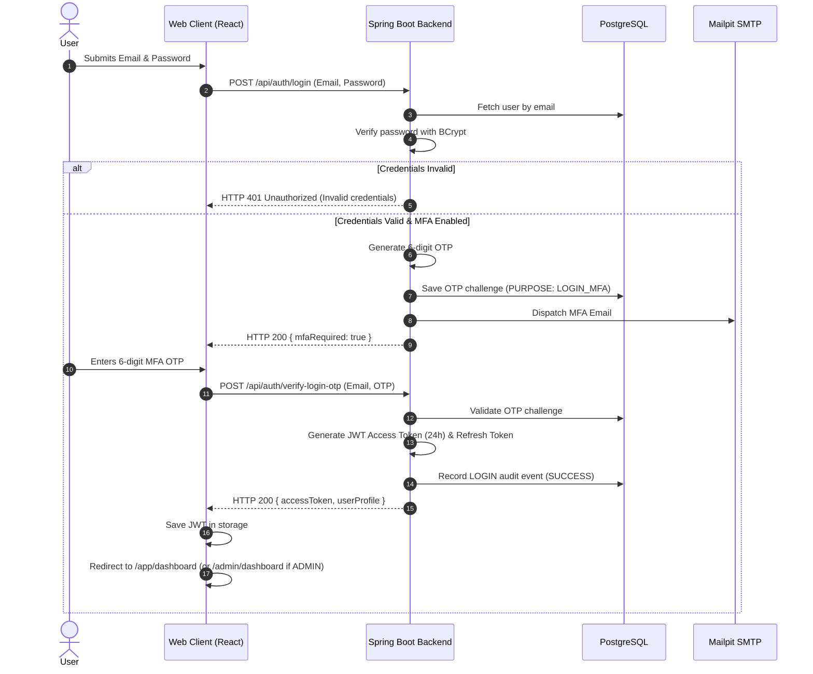
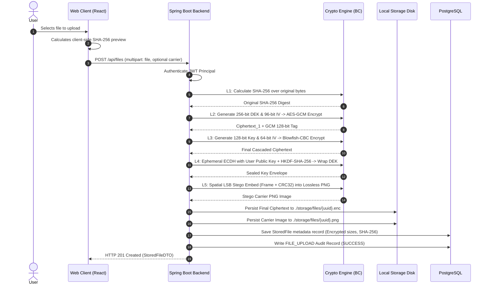
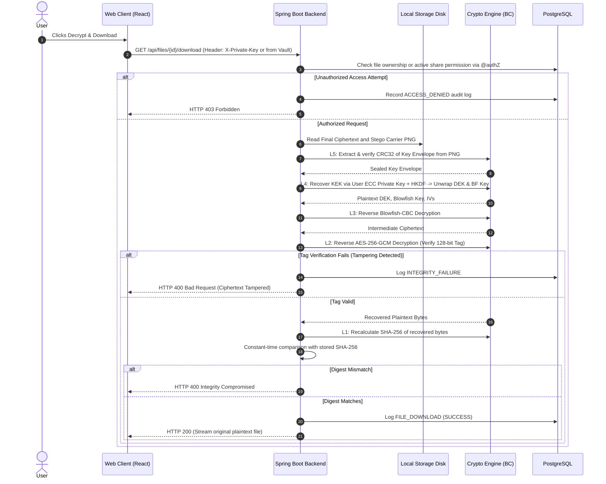
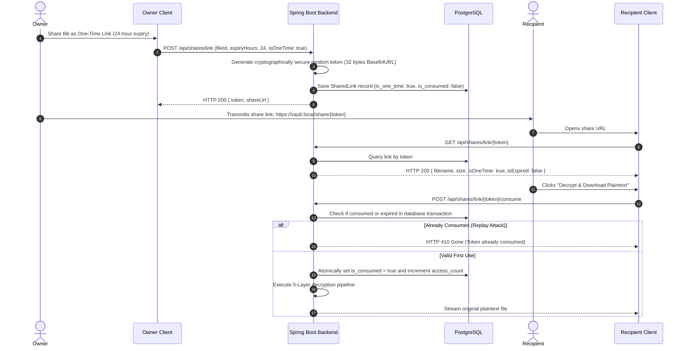
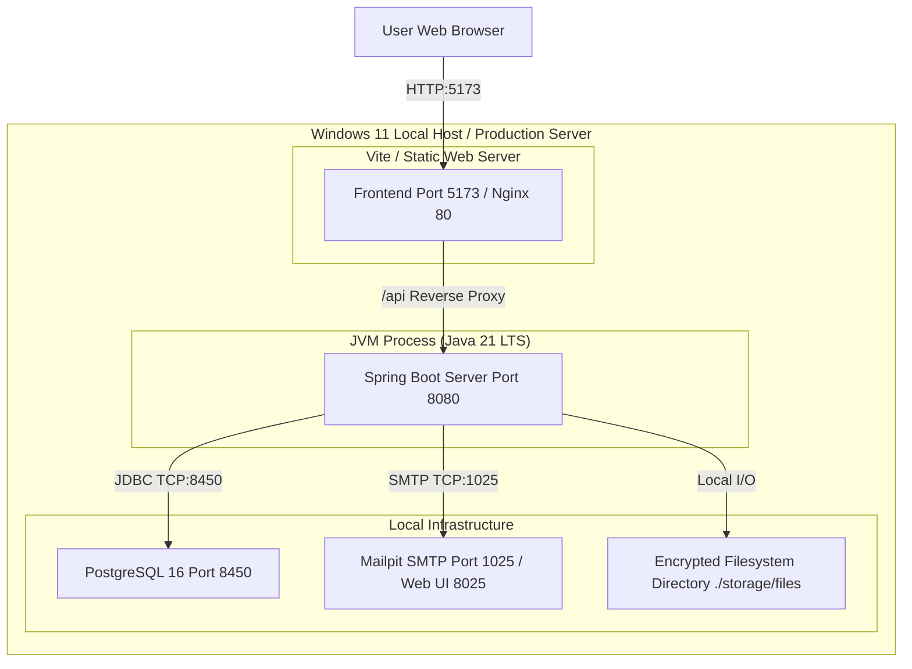

# System Architecture & Cryptographic Sequence Diagrams

**Project Title:** A Multi-Layer Secure File Storage and Sharing Framework Using Hybrid Cryptography and Steganographic Key Management in Cloud Environments  
**Institution:** SJC Institute of Technology (SJCIT), Department of Computer Science & Engineering  

---

## 1. High-Level Architecture Diagram

---

## 2. Component Diagram

```mermaid
graph LR
    subgraph Frontend ["Frontend Portal (React 18 + Vite)"]
        UserUI["User Portal (/app/*)"]
        AdminUI["Admin Portal (/admin/*)"]
        KeyringContext["Auth & Keyring Context"]
        AxiosClient["Axios Interceptor (Bearer + X-Private-Key)"]
    end

    subgraph BackendCore ["Spring Boot 3 Backend Core"]
        SecFilter["Security Filter Chain (JWT)"]
        Controllers["REST Controllers (Auth, File, Share, Admin, Notif)"]
        Services["Domain Services (FileService, ShareService, AdminService)"]
    end

    subgraph CryptoLayer ["5-Layer Hybrid Cryptosystem"]
        L1["L1: SHA-256 Digest"]
        L2["L2: AES-256-GCM (DEK)"]
        L3["L3: Blowfish-CBC (Cascaded)"]
        L4["L4: NIST P-256 ECDH + HKDF"]
        L5["L5: Spatial LSB PNG Stego"]
    end

    subgraph StorageInfra ["Persistence & Storage"]
        DB[("PostgreSQL 16 (Port 8450)")]
        DiskStorage["./storage/files (Path-Protected)"]
    end

    UserUI --> AxiosClient
    AdminUI --> AxiosClient
    KeyringContext --> AxiosClient
    AxiosClient --> SecFilter
    SecFilter --> Controllers
    Controllers --> Services
    Services --> CryptoLayer
    CryptoLayer --> DiskStorage
    Services --> DB
```

---

## 3. Entity-Relationship (ER) Diagram

---

## 4. Registration & Email Verification Sequence

---

## 5. Password & MFA OTP Login Sequence

---

## 6. File Upload & 5-Layer Encryption Sequence

---

## 7. File Download & Decryption Sequence

---

## 8. Ephemeral One-Time Sharing Sequence

---

## 9. Deployment Architecture Diagram

